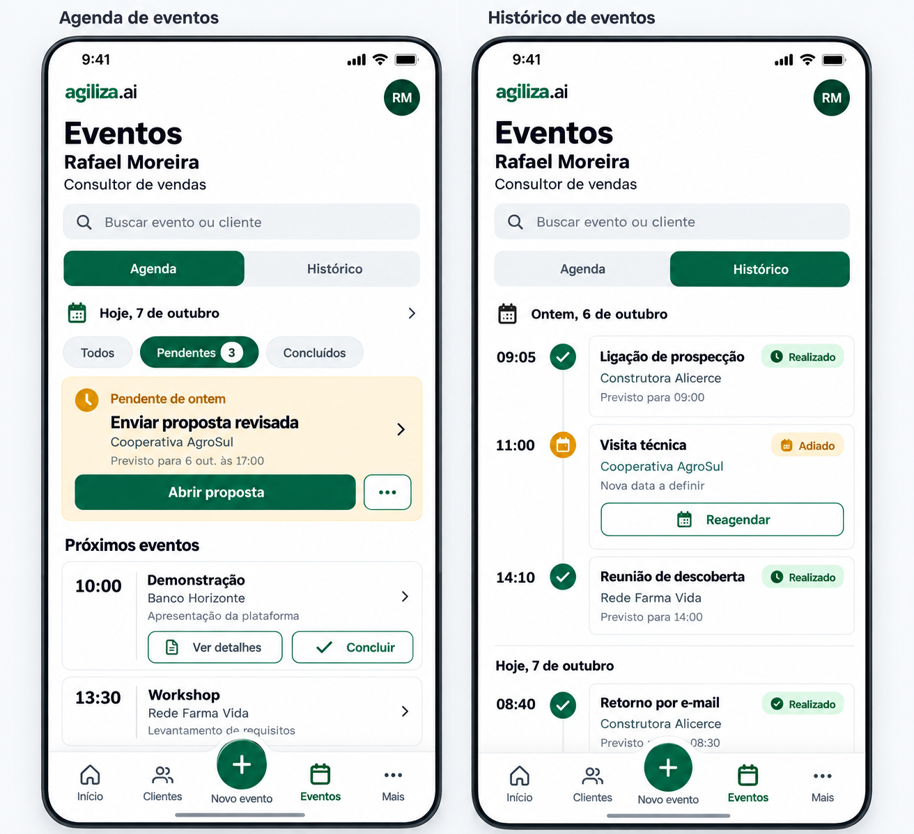

# 🧩 Task 004 — Criar variante da timeline

- Status: in-progress
- Type: feat
- Assignee: sidartaveloso

## Description

Criar variante da timeline, conforme projeto gráfico 

O projeto gráfico tem duas telas do agiliza.ai, a partir da agenda do consultor de vendas da story Cartões:

- **Agenda de eventos:** o dia, os filtros, o pendente de ontem em destaque e os próximos eventos com ações.
- **Histórico de eventos:** os eventos já resolvidos, por dia, com a hora, o marcador do status e um cartão.

## Decisões

1. **Variante da Timeline + agenda + template.** O histórico é uma linha do tempo, e virou a aparência `agiliza` da Timeline: o separador e o evento trocam de subcomponente, como na aparência `cartoes`. A agenda não é cronológica, e virou um organismo próprio (`AgendaEventos`). A tela inteira virou um template (`TemplateAgenda`).
2. **Marca fora da biblioteca.** As cores do agiliza.ai são tokens (`temaAgiliza`, no mock), aplicados num contêiner nas stories. Os componentes não conhecem a marca. O logo entra pelo slot `marca`. A barra de navegação do aplicativo, com Início, Clientes, Novo evento, Eventos e Mais, fica com o aplicativo.
3. **Ações vêm do evento.** "Abrir proposta", "Reagendar", "Ver detalhes" e "Concluir" dependem do negócio. Por isso vêm do campo `acoes` do `Evento` e saem no `acaoClick`, separado do `eventoClick`.
4. **Agenda × histórico pelo status.** São pendentes `planejado`, `atrasado` e `adiantado`, que ficam na agenda. O histórico mostra os resolvidos: realizados, adiados e cancelados. A regra fica em `utils/agenda`, e a agenda não altera o status dos eventos.
5. **Nome `TemplateAgenda`.** `TemplateEventos` diferiria do `TemplateEvento`, o detalhe de um evento, por uma letra.

## Reaproveitamento

- **Da timeline-vue:**
  - `Timeline`, com a nova aparência.
  - `Hora`.
  - `Botao`, nas ações.
  - `SeloStatus`, que ganhou a aparência `preenchido`. Seu registro `SELOS_STATUS` passou a ter a cor e o ícone do marcador.
  - `AvatarTimeline`, que ganhou as `iniciais`.
  - A lógica de datas do `SeparadorPeriodoCartao`, extraída para `utils/datas`.
- **Do storytype (`@storytype/components`):** a função de iniciais do Avatar, adaptada em `utils/texto`. Os demais componentes dependem do Quasar e não cobrem a tela.
- **Do mobi-gv:** os componentes do app dependem do Quasar. Serviram de referência os protótipos em CSS puro do Storybook. O controle segmentado de `stories/proposta/proposta.scss` deu origem ao `SeletorOpcoes` segmentado. A linha com seta de `stories/cupertino/LinhaLista.vue` deu origem ao `EventoAgenda`.
- **Novos, por falta de equivalente:**
  - `MarcoStatus`
  - `AcoesEvento`
  - `CampoBusca`
  - `SeletorOpcoes` (segmentado e chips)
  - `SeparadorPeriodoAgiliza`
  - `EventoTimelineAgiliza`
  - `EventoAgenda`
  - `EventoPendente`
  - `AgendaEventos`
  - `TemplateAgenda`

## Tasks

<!-- [x] feito · [ ] em aberto · [ ] ... — adiado: <razão> para o que se decidiu não fazer -->

- [x] Aparência `agiliza` da Timeline (`SeparadorPeriodoAgiliza`, `EventoTimelineAgiliza`, `MarcoStatus`)
- [x] Ações do evento (`AcaoEvento`, `AcoesEvento`, `acaoClick`)
- [x] Agenda do dia (`AgendaEventos`, `EventoPendente`, `EventoAgenda`, `SeletorOpcoes`, `utils/agenda`)
- [x] Tela (`TemplateAgenda`, `CampoBusca`, avatar com iniciais, `perfil.descricao`)
- [x] Stories de cada componente, com o caso do consultor e os tokens do agiliza.ai
- [x] Testes unitários e axe nas stories, nos temas claro e escuro
- [x] Timeline reativa à troca da lista, que a busca exige (item 7 da task-003)
- [ ] ... — adiado: barra de navegação inferior e logo, que são do aplicativo

## Notes

- **Item 7 da task-003.** A aba Histórico filtra a lista pela busca, e a Timeline não reagia à troca da prop. A correção entrou aqui, com testes:
  - a lista passa a ser lida da prop atual;
  - a lista recebida não é mais reordenada;
  - há um único `setInterval`, limpo ao desmontar.
- **`Hora` com dois dígitos.** Agora mostra `09:05`, o formato HH:MM que a própria story já descrevia, e não mais `9:05`. Isso vale para todas as aparências.
- **`Botao` não aplica `aparencia` nem `tamanho`.** O `:class="classes"` saiu do template no a1b1975. Religá-lo ativa estilos de outros componentes que reprovam no contraste, e 8 stories caem no axe:
  - `AreaSalvamento`: `#1b2f39` sobre `#0187b1`;
  - `BotaoStatus` realizado: `#1b2f39` sobre `#00a816`.

  Corrigido em seguida, na branch `fix/botao-aparencia-tamanho`: o Botao voltou a aplicar as classes, o texto sobre as cores de ação, sucesso e importante ganhou tokens (`--cor-texto-acao`, `--cor-texto-sucesso`, `--cor-texto-importante`), e o `AcoesEvento` deixou de pôr a classe `preenchido` pela raiz do Botao.

- **Ajustes no `Botao`.** Ele ganhou o ícone centralizado quando não há título. Com título, o nome da ligadura (`edit_calendar`) saiu do nome acessível.
- **Desvios do projeto gráfico.**
  - A fonte é a do sistema: a imagem não identifica a fonte, e a biblioteca não carrega fontes externas.
  - Os títulos longos quebram em duas linhas em telas estreitas.
- **Ícones decorativos.** Os novos componentes desenham os ícones decorativos num pseudo-elemento. Como texto do DOM, a ligadura é medida pelo axe sempre que a fonte ainda não carregou, e os testes ficavam instáveis.
